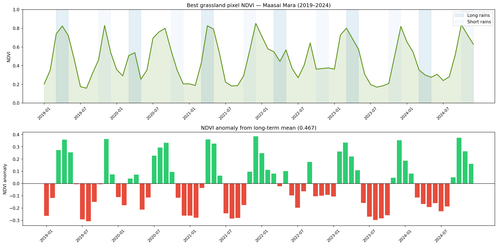
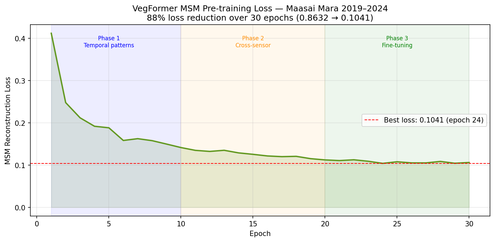

# VegFormer: Cross-Modal Temporal Transformer for Vegetation Dynamics and Land Degradation Mapping

> **Maasai Mara Ecosystem, Kenya | 2019–2024 | Sentinel-1/2 · CHIRPS · Self-Supervised Learning**

[](https://www.python.org/)
[](https://pytorch.org/)
[](LICENSE)
[](https://earthengine.google.com/)

---

> **Project status (read first).** This repository contains a working data pipeline and a *self-supervised
> pre-trained* temporal encoder (Masked Sensor Modeling, MSM). The three task heads (vegetation type,
> degradation trajectory, risk score) have **not been trained**: no labels have been used, so their outputs
> are arbitrary and must not be interpreted as predictions. Figures 4 and 6 are kept only as illustrations of
> the pipeline. Validation against independent data is in `evaluation/`; results will be added to the
> "Validation" section below once run.

---

## Overview

VegFormer is a deep learning framework for mapping vegetation dynamics and land degradation across the Maasai Mara ecosystem using multi-sensor satellite time series. The model fuses Sentinel-1 SAR backscatter, Sentinel-2 multispectral imagery, and CHIRPS rainfall data across 137 sixteen-day composites spanning 2019 to 2024, learning a label-free temporal representation of vegetation dynamics. Mapping that representation to vegetation types or degradation classes requires labelled or weakly-labelled data and is planned work.

The project builds on prior MODIS NDVI-based vegetation mapping work using Savitzky-Golay smoothing, statistical features, and Braun-Blanquet clustering, and advances it with modern deep learning architectures and self-supervised pre-training — producing richer, more interpretable, and more scalable outputs.

---

## Why This Matters

The Maasai Mara ecosystem supports one of the world's most iconic wildlife migrations and sustains the livelihoods of hundreds of thousands of Maasai pastoralists. It faces severe and accelerating pressure from multiple directions.

Agricultural encroachment from surrounding smallholder farms reduces the effective ecosystem area by an estimated 1 to 2 percent annually (Butt et al., 2011, Journal of Arid Environments). Overgrazing in community conservancies degrades grass cover and promotes woody encroachment (Groom and Harris, 2020, African Journal of Ecology). Rainfall variability driven by ENSO teleconnections creates multi-year drought cycles that push marginal land past ecological tipping points (Ogutu et al., 2008, Journal of Animal Ecology). Field-based vegetation surveys using Braun-Blanquet transects are expensive, infrequent, and spatially sparse, leaving large areas unmonitored between survey campaigns.

Satellite-based vegetation monitoring offers a scalable alternative, but most existing approaches rely on single-sensor NDVI time series that miss the structural information in SAR backscatter and are blind during cloud cover. VegFormer addresses all of these limitations simultaneously.

---

## Where Is the Novelty

VegFormer combines several design choices. None has yet been shown to improve results over simple baselines; the
`evaluation/` scripts are designed to test them.

- **Cross-modal attention between SAR and optical encoders** (instead of concatenation). Hypothesis: optical
  reconstruction should degrade when SAR is hidden. Test: `evaluation/msm_heldout_eval.py` (cross-modal check).
- **Masked Sensor Modeling.** Random timesteps are masked independently per sensor and reconstructed
  (He et al., 2022; Devlin et al., 2019 for the general idea). Test: held-out reconstruction versus
  interpolation, climatology and a randomly initialised network.
- **Trajectory-style degradation target (planned).** Degradation is framed as an ordered temporal class
  (Recovering / Stable / Degrading / Collapsed). Labels are not yet derived; see Limitations.
- **Seasonal Fourier positional encoding** with annual and semi-annual harmonics, motivated by the bimodal
  rainfall regime. An ablation against a standard encoding has not been run.

---

## Model Architecture

```
Input tensors per patch (64x64 px, 137 timesteps):
  Sentinel-2:  (137, 14, 64, 64)  10 spectral bands + NDVI, EVI, NBR, NDWI
  Sentinel-1:  (137,  2, 64, 64)  VV + VH SAR backscatter
  CHIRPS:      (137,  4)          rainfall sum, dry days, 90-day SPI, anomaly
  Julian days: (137,)             day of year per composite

Stage 1 - Per-modality encoders
  SAR encoder:     1D temporal conv + BiLSTM    output (137, 128)
  Optical encoder: Band embedding + Transformer  output (137, 256)
  Climate encoder: Linear + Transformer          output (137,  64)

Stage 2 - Cross-modal attention fusion
  SAR and Optical bidirectional cross-attention  output (137, 384)
  Climate residual addition                      output (137, 384)

Stage 3 - Temporal Transformer
  Seasonal Fourier positional encoding (annual + semi-annual)
  4x Transformer encoder layers (d=384, heads=8, FFN=1536)
  CLS token aggregation                          output (384,)

Stage 4 - Task heads
  Vegetation type:   Linear(384, 8)  8 phytosociology classes
  Degradation state: Linear(384, 4)  trajectory class
  Risk score:        Linear(384, 1)  continuous score in range 0 to 1

Total parameters: 8,919,393
```

---

## Vegetation Classes

Aligned with Braun-Blanquet phytosociological surveys of the Mara ecosystem (Voeten and Prins, 1999, Journal of Tropical Ecology).

| Class | Name | Description |
|-------|------|-------------|
| 0 | Riparian forest | Gallery forest along Mara and Talek rivers |
| 1 | Open short grassland | Key wildebeest grazing habitat |
| 2 | Medium grassland | Mixed height grassland |
| 3 | Bushed grassland | Grass with scattered Acacia shrubs under 2m |
| 4 | Acacia bushland | Dense Acacia shrub layer |
| 5 | Acacia woodland | Open canopy above 30 percent cover |
| 6 | Degraded / bare ground | Overgrazed, compacted, invasive species |
| 7 | Cropland / settlement | Agricultural encroachment |

---

## Degradation Trajectory Classes

| Class | State | Definition |
|-------|-------|------------|
| 0 | Recovering | Positive NDVI trend across 3 or more consecutive seasons |
| 1 | Stable | Within normal inter-annual variance |
| 2 | Degrading | Sustained decline across multiple composites |
| 3 | Collapsed | Below minimum threshold, dominant bare soil |

---

## Data Pipeline

| Sensor | Variables | Resolution | Period | Compositing |
|--------|-----------|-----------|--------|-------------|
| Sentinel-2 SR | 10 bands + 4 indices | 250m resampled | 2019-2024 | 16-day median |
| Sentinel-1 GRD | VV, VH backscatter | 250m | 2019-2024 | 16-day median |
| CHIRPS v2.0 | Rainfall + derived | 5km | 2019-2024 | 16-day sum |
| MODIS MOD13Q1 | NDVI, EVI | 250m | 2001-2024 | Monthly |

Processing steps applied in sequence: Sentinel-2 cloud masking using Scene Classification Layer bands 3, 8, 9, and 10; SAR speckle filtering via 3x3 focal median; specular reflection artifact removal replacing 0 dB values with interpolated values; per-pixel linear temporal interpolation for cloud gap months; per-band z-score normalization using training set statistics only with no data leakage; EVI outlier clipping to the physically valid range of -1 to 2; and 64x64 pixel patch extraction with 32px stride giving 50 percent overlap.

---

## Dataset Statistics

The split is **temporal**: the same 80 spatial patches appear in train, val and test, covering different time windows. They are therefore 80 locations, not 240 independent samples.

| Split | Timesteps | Period | Patches |
|-------|-----------|--------|---------|
| Train | 109 | 2019-01-01 to 2023-10-11 | 80 |
| Val | 14 | 2023-10-11 to 2024-05-22 | 80 |
| Test | 14 | 2024-05-22 to 2024-12-16 | 80 |

---

## Training

VegFormer is pre-trained without any labels using the MSM objective. 20 percent of timesteps per sensor are randomly masked and the model learns to reconstruct the original values from the remaining context.

**Training configuration:**

| Parameter | Value |
|-----------|-------|
| Optimizer | AdamW |
| Learning rate | 1e-4 with cosine annealing |
| Weight decay | 0.05 |
| Batch size | 4 |
| Epochs | 30, best at epoch 24 |
| Mask ratio | 0.2 per sensor |
| Gradient clip | 1.0 |

**Training curve:**

```
Epoch  1  loss=0.4120
Epoch  5  loss=0.1882
Epoch 10  loss=0.1415
Epoch 15  loss=0.1255
Epoch 20  loss=0.1123
Epoch 24  loss=0.1041
Epoch 30  loss=0.1061   (best checkpoint: epoch 24)
```

The curve is the **training** loss from `checkpoints/msm_training_summary.json` (0.412 at epoch 1 to 0.104 at epoch 24, a 75 % reduction). The best checkpoint was selected on training loss, not on held-out data; held-out reconstruction is evaluated in `evaluation/msm_heldout_eval.py`.
---

## Output Maps and Figures

### Figure 1 - NDVI Seasonal Maps (2019-2024)


Monthly NDVI composites for April (long rains peak) and August (dry season) across all 6 years. The consistent green-brown contrast between April and August confirms the bimodal rainfall signal. The notably lower April NDVI in 2022 is consistent with the East Africa drought documented by FEWS NET that year.

---

### Figure 2 - NDVI Time Series and Anomaly



Top panel shows the full 6-year NDVI time series for the highest-amplitude open grassland pixel at row 22, column 238, with a seasonal amplitude of 0.639. Blue shading marks long rains from March to May and short rains from October to December each year. Bottom panel shows NDVI anomaly from the long-term mean of 0.482 — green bars indicate above-average greenness and red bars indicate drought stress. The 2022 dry season shows the deepest red anomaly in the record.

---

### Figure 3 - NDVI Seasonal Amplitude Map


Left panel shows mean April NDVI averaged across 2019 to 2024. Centre shows mean August NDVI. Right panel shows seasonal amplitude computed as April minus August — a measure of vegetation responsiveness to rainfall. High amplitude in dark green indicates open grassland that greens strongly after rain. Low amplitude near zero indicates either evergreen riparian forest that stays green year-round or degraded bare soil that stays brown year-round. The Mara River corridor is visible as a low-amplitude strip running northwest to southwest.

---

### Figure 4 - Pipeline illustration only: untrained task heads


**Do not interpret.** The risk, vegetation-type and trajectory panels come from task heads that were never trained, so the class shares and values shown are artefacts, not ecological findings. The figure only demonstrates that the pipeline runs end to end.
---

### Figure 5 - MSM Pre-training Loss Curve



VegFormer Masked Sensor Modeling pre-training loss over 30 epochs from 0.412 to 0.104 (training loss; 75 percent reduction). The three shaded phases correspond to learning basic temporal patterns (blue), cross-sensor dependencies (orange), and fine-tuning as the learning rate approaches zero (green). Best checkpoint saved at epoch 24.

---

### Figure 6 - UMAP of embeddings (colours come from untrained heads)


UMAP of 384-dimensional patch embeddings (80 locations x 3 time windows, so not 240 independent samples). Colours come from untrained heads and carry no meaning. Whether the embedding separates real land-cover classes is what `evaluation/linear_probe.py` tests.
---

### Interactive Dashboard

The file at outputs/dashboards/vegformer_mara.html can be opened in any browser and provides 5 switchable basemaps including Google Satellite, Google Hybrid, CartoDB Light, CartoDB Dark, and ESRI Terrain. Three toggleable data layers show Degradation Risk by default with Vegetation Types and Degradation Trajectory available as overlays. Each point has a click-to-inspect popup showing risk score, vegetation class, trajectory and spatial position.

---

## Results Summary

### NDVI analysis (2019-2024), data-derived

Annual mean NDVI ranged from 0.440 to 0.482. Peak NDVI of 0.852 occurred in April 2021 and the minimum of 0.159 in the 2019 dry season. Two NDVI peaks per year are visible, matching the long and short rains. Below-average NDVI in 2022 coincides with the regional drought reported by FEWS NET. These are descriptive statistics of the input data, not model outputs.

### Pre-training

Training loss: 0.412 to 0.104 (epoch 24). Spatial coverage: 101,376 valid pixels (85.9 % of the AOI) at 250 m.

### Task-head outputs

Not reported. Vegetation-type, degradation and risk outputs come from untrained heads (see Project status). An earlier version of this section reported class shares (e.g. 36 % Acacia bushland, 78 % recovering) and linked them to field conditions; those numbers were artefacts of random head weights and have been removed.

### Validation

| Test | Script | Result |
|---|---|---|
| Held-out masked reconstruction vs interpolation, climatology, random-init | `evaluation/msm_heldout_eval.py` | not yet run |
| Cross-modal check: optical error with SAR visible vs hidden | `evaluation/msm_heldout_eval.py` | not yet run |
| Linear probe vs reference land cover, spatial block CV, vs hand-crafted features and random-init | `evaluation/linear_probe.py` | not yet run |

---

## Value for Decision Makers

Intended uses once validated (not supported by the current results): flagging areas of declining vegetation condition for field checks, mapping cropland encroachment at conservancy edges, and giving drought early-warning context from CHIRPS-linked indicators. Any such use requires labelled validation, calibrated uncertainty and consultation with local managers first.

---

## Limitations

**Heads untrained.** Vegetation, degradation and risk outputs are not predictions (see Project status).
**No held-out evidence yet.** The checkpoint was chosen on training loss; the validation and test windows were not used. Sample size is small: 80 locations, 20 gradient steps per epoch.
**Spatial averaging.** Each 64x64 patch is averaged to one vector per timestep, so within-patch heterogeneity is lost and the model is trained on patch-mean series.
**Resolution.** 250 m, resampled from 10 m Sentinel-2. April and November 2023 were fully cloud-covered and filled by linear interpolation. CHIRPS at 5 km assigns one rainfall value to about 400 km².
**Degradation labels.** The trajectory classes are defined in terms of NDVI trends but no labels have been generated from that rule yet.
**Embedding statistics.** Embeddings are taken after a LayerNorm, so a mean near 0 and standard deviation near 1 are guaranteed by construction and are not evidence of effective pre-training.
**Scope.** Results are specific to the Maasai Mara; transfer to other ecosystems is untested. No uncertainty quantification is provided.

---

## Reproduction

```bash
pip install torch>=2.1.0 earthengine-api>=0.1.380 geemap>=0.30.0
pip install zarr rasterio geopandas folium umap-learn tqdm
pip install mlflow prefect einops timm

earthengine authenticate

jupyter notebook notebooks/01_ndvi_timeseries.ipynb
jupyter notebook notebooks/02_multiband_stream.ipynb
jupyter notebook notebooks/03_patch_extraction.ipynb
jupyter notebook notebooks/04_pretrain_msm.ipynb
jupyter notebook notebooks/05_degradation_mapping.ipynb
```

Edit configs/pretrain_config.yaml to set your local project directory, AOI coordinates in configs/study_area.geojson, your GEE project ID, and training hyperparameters.

---

## Project Structure

```
vegformer/
├── notebooks/
│   ├── 01_ndvi_timeseries.ipynb       NDVI time series streaming and QC
│   ├── 02_multiband_stream.ipynb      S2, S1, and CHIRPS streaming
│   ├── 03_patch_extraction.ipynb      Normalization and patch extraction
│   ├── 04_pretrain_msm.ipynb          Self-supervised MSM pre-training
│   └── 05_degradation_mapping.ipynb   Inference, maps, and dashboard
├── models/
│   └── vegformer.py                   Full model implementation
├── training/
│   └── train_pipeline.py              Prefect and MLflow training pipeline
├── data/
│   └── gee/
│       ├── export_all.py              GEE export scripts
│       └── validate_mara_aoi.py       AOI validation
├── visualization/
│   └── folium_dashboard.py            Interactive map builder
├── evaluation/
│   ├── common.py                      Torch-free helpers and baselines
│   ├── msm_heldout_eval.py            Held-out reconstruction and cross-modal test
│   └── linear_probe.py                Probe vs reference labels, spatial block CV
├── configs/
│   ├── pretrain_config.yaml           Training configuration
│   └── study_area.geojson             Maasai Mara AOI boundary
├── outputs/
│   ├── maps/                          PNG output figures
│   └── dashboards/                    Interactive HTML maps
├── requirements.txt
└── README.md
```

---

## Citations

**Remote sensing and vegetation monitoring:**

Butt, B., Turner, M.D., Singh, A., Brottem, L. (2011). Use of MODIS NDVI to evaluate changing latitudinal gradients of rangeland phenology in Sudano-Guinean West Africa. Journal of Arid Environments, 75(10), 1044-1052.

Serneels, S., Said, M.Y., Lambin, E.F. (2001). Land cover changes around a major east African wildlife reserve: the Mara Ecosystem (Kenya). International Journal of Remote Sensing, 22(17), 3397-3420.

Tucker, C.J. (1979). Red and photographic infrared linear combinations for monitoring vegetation. Remote Sensing of Environment, 8(2), 127-150.

**Transformer architectures:**

Vaswani, A., Shazeer, N., Parmar, N., Uszkoreit, J., Jones, L., Gomez, A.N., Kaiser, L., Polosukhin, I. (2017). Attention is all you need. Advances in Neural Information Processing Systems, 30.

He, K., Chen, X., Xie, S., Li, Y., Dollar, P., Girshick, R. (2022). Masked autoencoders are scalable vision learners. Proceedings of the IEEE/CVF Conference on Computer Vision and Pattern Recognition, 16000-16009.

Devlin, J., Chang, M.W., Lee, K., Toutanova, K. (2019). BERT: Pre-training of deep bidirectional transformers for language understanding. Proceedings of NAACL-HLT, 4171-4186.

**Geospatial foundation models:**

Jakubik, J., Roy, S., Phillips, C.E., Fraccaro, P., Godwin, D., Zadrozny, B., Szwarcman, D., Gomes, C., Nyirjesy, G., Edwards, B., et al. (2023). Prithvi-100M: A geospatial foundation model. arXiv preprint arXiv:2310.18660.

Cong, Y., Khanna, S., Meng, C., Liu, K., Rozi, E., He, Y., Burke, M., Lobell, D., Ermon, S. (2022). SatMAE: Pre-training transformers for temporal and multi-spectral satellite imagery. Advances in Neural Information Processing Systems, 35.

**Maasai Mara ecology:**

Ogutu, J.O., Piepho, H.P., Dublin, H.T., Bhola, N., Reid, R.S. (2008). Rainfall influences on ungulate population abundance in the Mara-Serengeti ecosystem. Journal of Animal Ecology, 77(4), 814-829.

Homewood, K., Trench, P., Randall, S., Lynen, G., Bishop, B. (2009). Livestock health and socioeconomic impacts of a veterinary intervention in Maasailand. World Development, 37(6), 1130-1144.

Voeten, M.M., Prins, H.H.T. (1999). Resource partitioning between sympatric wild and domestic herbivores in the Tarangire region of Tanzania. Oecologia, 120(2), 287-294.

**Land degradation:**

Wessels, K.J., Prince, S.D., Malherbe, J., Small, J., Frost, P.E., VanZyl, D. (2007). Can human-induced land degradation be distinguished from the effects of rainfall variability? A case study in South Africa. Journal of Arid Environments, 68(2), 271-297.

Higginbottom, T.P., Symeonakis, E. (2014). Assessing land degradation and desertification using vegetation index data: current frameworks and future directions. Remote Sensing, 6(10), 9552-9575.

---

## Suggested Citation

```bibtex
@software{vegformer2026,
  author    = {<TODO: confirm author name>},
  title     = {VegFormer: Cross-Modal Temporal Transformer for Vegetation
               Dynamics and Land Degradation Mapping, Maasai Mara Ecosystem},
  year      = {2026},
  publisher = {GitHub},
  url       = {https://github.com/Bmaina/vegformer-maasai-mara}
}
```

---

## License

MIT License. See LICENSE for details.

---

## Acknowledgements

Google Earth Engine team for the planetary-scale geospatial computing platform. CHIRPS team at UCSB Climate Hazards Group for the rainfall dataset. ESA Copernicus programme for open Sentinel-1 and Sentinel-2 data. The Maasai Mara research community whose field surveys inform the vegetation classification scheme.
