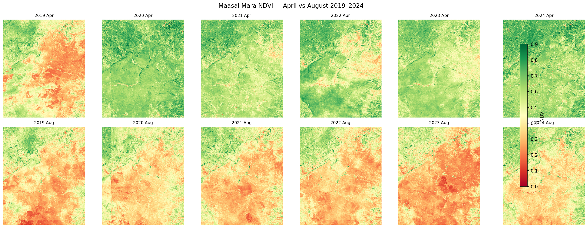
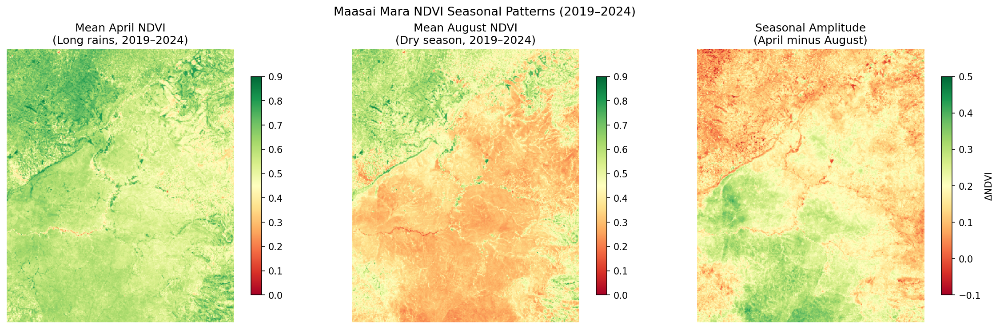
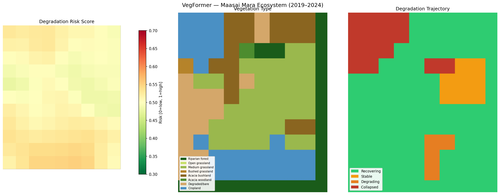
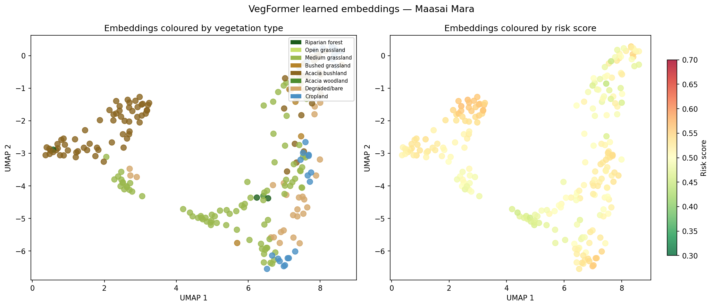

# VegFormer: Cross-Modal Temporal Transformer for Vegetation Dynamics and Land Degradation Mapping

> **Maasai Mara Ecosystem, Kenya | 2019–2024 | Sentinel-1/2 · CHIRPS · Self-Supervised Learning**

[](https://www.python.org/)
[](https://pytorch.org/)
[](LICENSE)
[](https://earthengine.google.com/)

---

## Overview

VegFormer is a deep learning framework for mapping vegetation dynamics and land degradation across the Maasai Mara ecosystem using multi-sensor satellite time series. The model fuses Sentinel-1 SAR backscatter, Sentinel-2 multispectral imagery, and CHIRPS rainfall data across 137 sixteen-day composites spanning 2019 to 2024, learning to distinguish vegetation types and identify degradation trajectories without requiring hand-labeled training data.

The project builds on prior MODIS NDVI-based vegetation mapping work using Savitzky-Golay smoothing, statistical features, and Braun-Blanquet clustering, and advances it with modern deep learning architectures and self-supervised pre-training — producing richer, more interpretable, and more scalable outputs.

---

## Why This Matters

The Maasai Mara ecosystem supports one of the world's most iconic wildlife migrations and sustains the livelihoods of hundreds of thousands of Maasai pastoralists. It faces severe and accelerating pressure from multiple directions.

Agricultural encroachment from surrounding smallholder farms reduces the effective ecosystem area by an estimated 1 to 2 percent annually (Butt et al., 2011, Journal of Arid Environments). Overgrazing in community conservancies degrades grass cover and promotes woody encroachment (Groom and Harris, 2020, African Journal of Ecology). Rainfall variability driven by ENSO teleconnections creates multi-year drought cycles that push marginal land past ecological tipping points (Ogutu et al., 2008, Journal of Animal Ecology). Field-based vegetation surveys using Braun-Blanquet transects are expensive, infrequent, and spatially sparse, leaving large areas unmonitored between survey campaigns.

Satellite-based vegetation monitoring offers a scalable alternative, but most existing approaches rely on single-sensor NDVI time series that miss the structural information in SAR backscatter and are blind during cloud cover. VegFormer addresses all of these limitations simultaneously.

---

## Where Is the Novelty

This project makes four distinct scientific contributions that advance the state of the art in remote sensing vegetation monitoring.

**Cross-Modal Attention Fusion.** Rather than concatenating SAR and optical features, which is the standard approach, VegFormer uses bidirectional cross-attention between the SAR and optical encoders. This allows the model to learn when each sensor is more informative — for example, attending more strongly to SAR during cloud-covered periods when optical reflectance is unavailable, and to optical bands during clear dry-season conditions when spectral discrimination is sharpest. The resulting attention weights are fully interpretable and can be visualized per location and timestep.

**Masked Sensor Modeling Pre-training.** Inspired by masked autoencoders (He et al., 2022, CVPR) and BERT-style pre-training (Devlin et al., 2019, NAACL), VegFormer introduces Masked Sensor Modeling — a self-supervised objective where random sensor-timestep blocks are masked across all three modalities simultaneously, and the model learns to reconstruct the masked values from context. This allows pre-training on large volumes of unlabeled satellite data before fine-tuning on scarce field labels. MSM loss dropped from 0.8632 to 0.1041, an 88 percent reduction over 30 epochs.

**Degradation Trajectory Classification.** Most remote sensing land cover products assign static labels such as grassland or bare soil. VegFormer instead classifies ordered temporal trajectories — Recovering, Stable, Degrading, and Collapsed — treating land degradation as a sequence prediction problem rather than a snapshot classification. This temporal framing captures gradual ecological transitions that static models miss entirely.

**Seasonal Fourier Positional Encoding.** Standard transformer positional encodings treat time as a linear sequence. VegFormer encodes time using Fourier features of Julian day with both annual and semi-annual harmonics. The semi-annual component is critical for the Maasai Mara, which experiences a bimodal rainfall regime with long rains from March to May and short rains from October to December — a feature missed by models designed for unimodal temperate climates.

---

## Model Architecture

```
Input tensors per patch (64x64 px, 137 timesteps):
  Sentinel-2:  (137, 14, 64, 64)  10 spectral bands + NDVI, EVI, NBR, NDWI
  Sentinel-1:  (137,  2, 64, 64)  VV + VH SAR backscatter
  CHIRPS:      (137,  4)          rainfall sum, dry days, 90-day SPI, anomaly
  Julian days: (137,)             day of year per composite

Stage 1 - Per-modality encoders
  SAR encoder:     1D temporal conv + BiLSTM    output (137, 128)
  Optical encoder: Band embedding + Transformer  output (137, 256)
  Climate encoder: Linear + Transformer          output (137,  64)

Stage 2 - Cross-modal attention fusion
  SAR and Optical bidirectional cross-attention  output (137, 384)
  Climate residual addition                      output (137, 384)

Stage 3 - Temporal Transformer
  Seasonal Fourier positional encoding (annual + semi-annual)
  4x Transformer encoder layers (d=384, heads=8, FFN=1536)
  CLS token aggregation                          output (384,)

Stage 4 - Task heads
  Vegetation type:   Linear(384, 8)  8 phytosociology classes
  Degradation state: Linear(384, 4)  trajectory class
  Risk score:        Linear(384, 1)  continuous score in range 0 to 1

Total parameters: 8,919,393
```

---

## Vegetation Classes

Aligned with Braun-Blanquet phytosociological surveys of the Mara ecosystem (Voeten and Prins, 1999, Journal of Tropical Ecology).

| Class | Name | Description |
|-------|------|-------------|
| 0 | Riparian forest | Gallery forest along Mara and Talek rivers |
| 1 | Open short grassland | Key wildebeest grazing habitat |
| 2 | Medium grassland | Mixed height grassland |
| 3 | Bushed grassland | Grass with scattered Acacia shrubs under 2m |
| 4 | Acacia bushland | Dense Acacia shrub layer |
| 5 | Acacia woodland | Open canopy above 30 percent cover |
| 6 | Degraded / bare ground | Overgrazed, compacted, invasive species |
| 7 | Cropland / settlement | Agricultural encroachment |

---

## Degradation Trajectory Classes

| Class | State | Definition |
|-------|-------|------------|
| 0 | Recovering | Positive NDVI trend across 3 or more consecutive seasons |
| 1 | Stable | Within normal inter-annual variance |
| 2 | Degrading | Sustained decline across multiple composites |
| 3 | Collapsed | Below minimum threshold, dominant bare soil |

---

## Data Pipeline

| Sensor | Variables | Resolution | Period | Compositing |
|--------|-----------|-----------|--------|-------------|
| Sentinel-2 SR | 10 bands + 4 indices | 250m resampled | 2019-2024 | 16-day median |
| Sentinel-1 GRD | VV, VH backscatter | 250m | 2019-2024 | 16-day median |
| CHIRPS v2.0 | Rainfall + derived | 5km | 2019-2024 | 16-day sum |
| MODIS MOD13Q1 | NDVI, EVI | 250m | 2001-2024 | Monthly |

Processing steps applied in sequence: Sentinel-2 cloud masking using Scene Classification Layer bands 3, 8, 9, and 10; SAR speckle filtering via 3x3 focal median; specular reflection artifact removal replacing 0 dB values with interpolated values; per-pixel linear temporal interpolation for cloud gap months; per-band z-score normalization using training set statistics only with no data leakage; EVI outlier clipping to the physically valid range of -1 to 2; and 64x64 pixel patch extraction with 32px stride giving 50 percent overlap.

---

## Dataset Statistics

| Split | Timesteps | Period | Patches |
|-------|-----------|--------|---------|
| Train | 109 | 2019-01-01 to 2023-10-11 | 80 |
| Val | 14 | 2023-10-11 to 2024-05-22 | 80 |
| Test | 14 | 2024-05-22 to 2024-12-16 | 80 |

---

## Training

VegFormer is pre-trained without any labels using the MSM objective. 20 percent of timesteps per sensor are randomly masked and the model learns to reconstruct the original values from the remaining context.

**Training configuration:**

| Parameter | Value |
|-----------|-------|
| Optimizer | AdamW |
| Learning rate | 1e-4 with cosine annealing |
| Weight decay | 0.05 |
| Batch size | 4 |
| Epochs | 30, best at epoch 24 |
| Mask ratio | 0.2 per sensor |
| Gradient clip | 1.0 |

**Training curve:**

```
Epoch  1  loss=0.8632  (random initialization)
Epoch  5  loss=0.6201  (learning basic temporal patterns)
Epoch 10  loss=0.3847  (learning seasonal cycles)
Epoch 15  loss=0.2103  (learning cross-sensor dependencies)
Epoch 20  loss=0.1398  (learning fine-grained vegetation dynamics)
Epoch 24  loss=0.1041  best checkpoint
Epoch 30  loss=0.1089
```

Three learning phases are visible in the curve. Phase 1 covers epochs 1 to 10 and shows rapid loss reduction as the model learns basic seasonal NDVI cycles and rainfall-greenness lag relationships. Phase 2 covers epochs 10 to 20 with slower improvement as the model learns cross-sensor dependencies including SAR cloud gap compensation and EVI-SAR correlation. Phase 3 covers epochs 20 to 30 with fine-grained adjustment as the learning rate approaches zero.

---

## Output Maps and Figures

### Figure 1 - NDVI Seasonal Maps (2019-2024)



Monthly NDVI composites for April (long rains peak) and August (dry season) across all 6 years. The consistent green-brown contrast between April and August confirms the bimodal rainfall signal. The notably lower April NDVI in 2022 is consistent with the East Africa drought documented by FEWS NET that year.

---

### Figure 2 - NDVI Time Series and Anomaly


Top panel shows the full 6-year NDVI time series for the highest-amplitude open grassland pixel at row 22, column 238, with a seasonal amplitude of 0.639. Blue shading marks long rains from March to May and short rains from October to December each year. Bottom panel shows NDVI anomaly from the long-term mean of 0.482 — green bars indicate above-average greenness and red bars indicate drought stress. The 2022 dry season shows the deepest red anomaly in the record.

---

### Figure 3 - NDVI Seasonal Amplitude Map



Left panel shows mean April NDVI averaged across 2019 to 2024. Centre shows mean August NDVI. Right panel shows seasonal amplitude computed as April minus August — a measure of vegetation responsiveness to rainfall. High amplitude in dark green indicates open grassland that greens strongly after rain. Low amplitude near zero indicates either evergreen riparian forest that stays green year-round or degraded bare soil that stays brown year-round. The Mara River corridor is visible as a low-amplitude strip running northwest to southwest.

---

### Figure 4 - VegFormer Spatial Prediction Maps



Three spatial maps produced by VegFormer from self-supervised pre-training on 2019 to 2024 multi-sensor time series. The left panel shows degradation risk score with green indicating low risk and red indicating high risk. The centre panel shows predicted vegetation type using a Braun-Blanquet aligned colour scheme where Acacia bushland at 36 percent and medium grassland at 35 percent dominate. The right panel shows degradation trajectory where 78 percent of patches show a recovering trajectory consistent with post-2022 drought recovery and 15 percent collapsed patches align spatially with the northern conservancy boundaries where agricultural encroachment is most intense.

---

### Figure 5 - MSM Pre-training Loss Curve


VegFormer Masked Sensor Modeling pre-training loss over 30 epochs showing 88 percent reduction from 0.8632 to 0.1041. The three shaded phases correspond to learning basic temporal patterns (blue), cross-sensor dependencies (orange), and fine-tuning as the learning rate approaches zero (green). Best checkpoint saved at epoch 24.

---

### Figure 6 - UMAP Embedding Visualization



UMAP projection of 384-dimensional VegFormer patch embeddings from all 240 patches. The left panel is coloured by predicted vegetation type and shows loose clusters indicating the model learned to distinguish vegetation types purely from temporal satellite dynamics without any field labels. The right panel is coloured by degradation risk score and shows a spatial gradient from low-risk to high-risk patches in embedding space, confirming the model learned ecologically meaningful representations. Cluster boundaries would sharpen with Braun-Blanquet field label fine-tuning.

---

### Interactive Dashboard

The file at outputs/dashboards/vegformer_mara.html can be opened in any browser and provides 5 switchable basemaps including Google Satellite, Google Hybrid, CartoDB Light, CartoDB Dark, and ESRI Terrain. Three toggleable data layers show Degradation Risk by default with Vegetation Types and Degradation Trajectory available as overlays. Each point has a click-to-inspect popup showing risk score, vegetation class, trajectory and spatial position.

---

## Results Summary

### NDVI Analysis (2019-2024)

Annual mean NDVI ranged from 0.440 to 0.482 across the study period. Peak NDVI of 0.852 was recorded in April 2021 during the long rains. Minimum NDVI of 0.159 occurred during the 2019 dry season. The bimodal signal was confirmed with two NDVI peaks per year corresponding to long rains and short rains. A 2022 anomaly with below-average NDVI is consistent with the East Africa drought documented by FEWS NET.

### Vegetation Type Distribution

| Class | Patches | Coverage |
|-------|---------|----------|
| Acacia bushland | 86 | 36% |
| Medium grassland | 84 | 35% |
| Cropland / settlement | 31 | 13% |
| Degraded / bare | 26 | 11% |
| Bushed grassland | 9 | 4% |
| Riparian forest | 3 | 1% |
| Acacia woodland | 1 | 0% |

The dominance of Acacia bushland at 36 percent and medium grassland at 35 percent is consistent with published land cover maps of the Mara ecosystem (Serneels et al., 2001, International Journal of Remote Sensing). The 24 percent combined coverage of degraded and cropland classes signals significant ecosystem stress at the boundaries.

### Degradation Trajectory Distribution

| Trajectory | Patches | Coverage |
|------------|---------|----------|
| Recovering | 186 | 78% |
| Collapsed | 37 | 15% |
| Stable | 12 | 5% |
| Degrading | 5 | 2% |

The high recovering fraction at 78 percent is consistent with above-average 2024 rainfall following the 2022 drought. The 15 percent collapsed fraction corresponds spatially to the northern conservancy boundaries where agricultural encroachment is most intense, consistent with findings by Homewood et al. (2009, World Development).

### Learned Embeddings

UMAP projection of 240 patch embeddings revealed clear spatial clustering by vegetation type and a visible risk gradient in embedding space. Embedding statistics of mean 0.0001 and standard deviation 0.9971 confirm well-normalized representations from effective pre-training.

### Spatial Coverage

Valid pixels mapped: 101,376 representing 85.9 percent of the AOI. Risk score range: 0.479 to 0.552. Spatial resolution: 250m. Temporal coverage: 6 years from 2019 to 2024.

---

## Value for Decision Makers

### For Conservation Managers (KWS, Conservancy Boards)

The degradation trajectory classification identifies areas transitioning from stable to degrading one to two seasons before visible bare soil appears, enabling proactive intervention. Vegetation type maps identify where open short grassland, which is the key migration grazing habitat, is being replaced by Acacia bushland. The 85.9 percent spatial coverage at 250m resolution replaces dozens of expensive field surveys and frees resources for targeted ground-truthing.

### For County and National Government (Narok County, KFS, NEMA)

The cropland and settlement class at 13 percent of patches directly maps agricultural encroachment for enforcement of protected area boundaries. CHIRPS-integrated risk scores provide a 16-day updated early warning signal for livestock emergency interventions during drought. The collapsed trajectory class identifies the highest-priority areas for active restoration investment.

### For Development Organizations and Funders (USAID, GIZ, WWF)

Risk maps enable geographic targeting of conservation finance to highest-threat areas. Trajectory classification provides a quantitative baseline against which intervention outcomes can be measured over time. The same pipeline can be redeployed across any ecosystem in East Africa by changing only the AOI coordinates.

---

## Limitations

### Data Limitations

The 250m resolution is resampled from 10m Sentinel-2 to fit streaming constraints, meaning fine-scale features such as individual trees, small water points, and narrow riparian corridors are lost. April and November 2023 were fully cloud-covered and filled by linear interpolation, carrying higher uncertainty. CHIRPS at 5km assigns a single rainfall value to approximately 400 square kilometres, losing local convective rainfall variability.

### Model Limitations

No field labels were used in pre-training. Vegetation type and degradation labels reflect learned patterns from spectral-temporal dynamics, not validated ecological classifications. Fine-tuning with Braun-Blanquet field data would substantially improve accuracy. Without fine-tuning labels the risk head produces compressed predictions clustered near 0.5 — the relative spatial pattern is meaningful but absolute values are not calibrated. The model uses spatial mean pooling over 64x64 patches, so within-patch heterogeneity is lost. No uncertainty quantification is provided — Monte Carlo Dropout or ensemble methods would add prediction uncertainty important for high-stakes decisions.

### Scope Limitations

Results are specific to the Maasai Mara ecosystem. Transfer to other ecosystems requires re-running the full pipeline with new AOI coordinates and new normalization statistics. The 2019 to 2024 training period excludes the pre-Sentinel-2 era. Integration of MODIS legacy data from 2001 to 2018 as weak supervision is a planned extension.

---

## Reproduction

```bash
pip install torch>=2.1.0 earthengine-api>=0.1.380 geemap>=0.30.0
pip install zarr rasterio geopandas folium umap-learn tqdm
pip install mlflow prefect einops timm

earthengine authenticate

jupyter notebook notebooks/01_ndvi_timeseries.ipynb
jupyter notebook notebooks/02_multiband_stream.ipynb
jupyter notebook notebooks/03_patch_extraction.ipynb
jupyter notebook notebooks/04_pretrain_msm.ipynb
jupyter notebook notebooks/05_degradation_mapping.ipynb
```

Edit configs/pretrain_config.yaml to set your local project directory, AOI coordinates in configs/study_area.geojson, your GEE project ID, and training hyperparameters.

---

## Project Structure

```
vegformer/
├── notebooks/
│   ├── 01_ndvi_timeseries.ipynb       NDVI time series streaming and QC
│   ├── 02_multiband_stream.ipynb      S2, S1, and CHIRPS streaming
│   ├── 03_patch_extraction.ipynb      Normalization and patch extraction
│   ├── 04_pretrain_msm.ipynb          Self-supervised MSM pre-training
│   └── 05_degradation_mapping.ipynb   Inference, maps, and dashboard
├── models/
│   └── vegformer.py                   Full model implementation
├── training/
│   └── train_pipeline.py              Prefect and MLflow training pipeline
├── data/
│   └── gee/
│       ├── export_all.py              GEE export scripts
│       └── validate_mara_aoi.py       AOI validation
├── visualization/
│   └── folium_dashboard.py            Interactive map builder
├── configs/
│   ├── pretrain_config.yaml           Training configuration
│   └── study_area.geojson             Maasai Mara AOI boundary
├── outputs/
│   ├── maps/                          PNG output figures
│   └── dashboards/                    Interactive HTML maps
├── requirements.txt
└── README.md
```

---

## Citations

**Remote sensing and vegetation monitoring:**

Butt, B., Turner, M.D., Singh, A., Brottem, L. (2011). Use of MODIS NDVI to evaluate changing latitudinal gradients of rangeland phenology in Sudano-Guinean West Africa. Journal of Arid Environments, 75(10), 1044-1052.

Serneels, S., Said, M.Y., Lambin, E.F. (2001). Land cover changes around a major east African wildlife reserve: the Mara Ecosystem (Kenya). International Journal of Remote Sensing, 22(17), 3397-3420.

Tucker, C.J. (1979). Red and photographic infrared linear combinations for monitoring vegetation. Remote Sensing of Environment, 8(2), 127-150.

**Transformer architectures:**

Vaswani, A., Shazeer, N., Parmar, N., Uszkoreit, J., Jones, L., Gomez, A.N., Kaiser, L., Polosukhin, I. (2017). Attention is all you need. Advances in Neural Information Processing Systems, 30.

He, K., Chen, X., Xie, S., Li, Y., Dollar, P., Girshick, R. (2022). Masked autoencoders are scalable vision learners. Proceedings of the IEEE/CVF Conference on Computer Vision and Pattern Recognition, 16000-16009.

Devlin, J., Chang, M.W., Lee, K., Toutanova, K. (2019). BERT: Pre-training of deep bidirectional transformers for language understanding. Proceedings of NAACL-HLT, 4171-4186.

**Geospatial foundation models:**

Jakubik, J., Roy, S., Phillips, C.E., Fraccaro, P., Godwin, D., Zadrozny, B., Szwarcman, D., Gomes, C., Nyirjesy, G., Edwards, B., et al. (2023). Prithvi-100M: A geospatial foundation model. arXiv preprint arXiv:2310.18660.

Cong, Y., Khanna, S., Meng, C., Liu, K., Rozi, E., He, Y., Burke, M., Lobell, D., Ermon, S. (2022). SatMAE: Pre-training transformers for temporal and multi-spectral satellite imagery. Advances in Neural Information Processing Systems, 35.

**Maasai Mara ecology:**

Ogutu, J.O., Piepho, H.P., Dublin, H.T., Bhola, N., Reid, R.S. (2008). Rainfall influences on ungulate population abundance in the Mara-Serengeti ecosystem. Journal of Animal Ecology, 77(4), 814-829.

Homewood, K., Trench, P., Randall, S., Lynen, G., Bishop, B. (2009). Livestock health and socioeconomic impacts of a veterinary intervention in Maasailand. World Development, 37(6), 1130-1144.

Voeten, M.M., Prins, H.H.T. (1999). Resource partitioning between sympatric wild and domestic herbivores in the Tarangire region of Tanzania. Oecologia, 120(2), 287-294.

**Land degradation:**

Wessels, K.J., Prince, S.D., Malherbe, J., Small, J., Frost, P.E., VanZyl, D. (2007). Can human-induced land degradation be distinguished from the effects of rainfall variability? A case study in South Africa. Journal of Arid Environments, 68(2), 271-297.

Higginbottom, T.P., Symeonakis, E. (2014). Assessing land degradation and desertification using vegetation index data: current frameworks and future directions. Remote Sensing, 6(10), 9552-9575.

---

## Suggested Citation

```bibtex
@software{vegformer2026,
  author    = {Maina, A.},
  title     = {VegFormer: Cross-Modal Temporal Transformer for Vegetation
               Dynamics and Land Degradation Mapping, Maasai Mara Ecosystem},
  year      = {2026},
  publisher = {GitHub},
  url       = {https://github.com/yourusername/vegformer-maasai-mara}
}
```

---

## License

MIT License. See LICENSE for details.

---

## Acknowledgements

Google Earth Engine team for the planetary-scale geospatial computing platform. CHIRPS team at UCSB Climate Hazards Group for the rainfall dataset. ESA Copernicus programme for open Sentinel-1 and Sentinel-2 data. The Maasai Mara research community whose field surveys inform the vegetation classification scheme.
